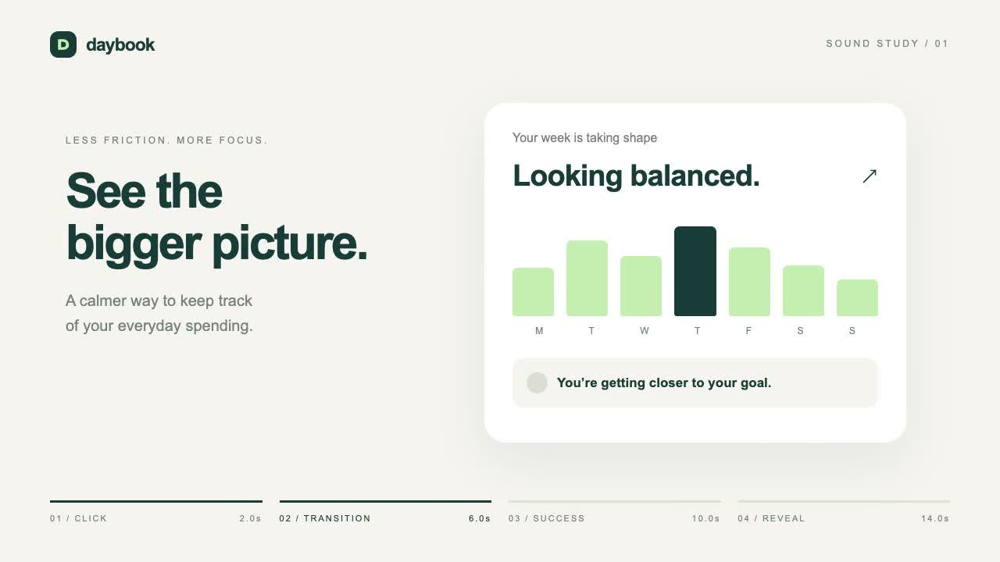

# 用 SFXMint MCP 给 Remotion 视频添加音效

[English](README.md) · [观看 18 秒成片](preview/daybook.mp4)

[](preview/daybook.mp4)

这个例子演示一个完整流程：让 AI 编程助手通过 SFXMint MCP 找音效，试听选定后，把文件放入 Remotion 时间轴。画面是虚构的 Daybook 记账 App，四个节点分别是 **2 秒点击、6 秒转场、10 秒成功提示、14 秒 Logo 出场**，没有旁白或背景音乐。

MCP 负责找声音，Remotion 负责安排时间和渲染。每次渲染都使用已经选好的本地文件，不会重新随机选材。

## 1. 先运行成品

需要 Node.js 22 或更新版本和 npm：

```bash
git clone https://github.com/flreey/sfxmint-mcp.git
cd sfxmint-mcp/examples/remotion
npm ci
npm test
npm start
```

在 Remotion Studio 选择 **Daybook**，开启声音播放。导出成片：

```bash
npm run render
```

输出 `out/daybook.mp4`，18 秒、1280×720、30fps。首次渲染可能下载 Chrome Headless Shell；也可以指定已有浏览器，例如 macOS 上的 Chrome：

```bash
npm run render -- --browser-executable="/Applications/Google Chrome.app/Contents/MacOS/Google Chrome"
```

四个音效及原始文件已附带，不需要账号、API key、Python 或单独安装 FFmpeg。安装依赖和首次准备浏览器需要网络。音效为 AI 生成/合成的 CC0 素材；Remotion 等依赖仍适用各自的许可证，见 [Remotion 授权说明](https://www.remotion.dev/docs/license)。

## 2. 把 MCP 接到编程助手

Claude Code：

```bash
claude mcp add --transport http sfxmint https://sfxmint.com/mcp
```

支持 `mcpServers` 的客户端可以使用：

```json
{
  "mcpServers": {
    "sfxmint": { "url": "https://sfxmint.com/mcp" }
  }
}
```

协议是 Streamable HTTP。必要时重新连接或重启客户端，确认它能看到 `get_role_sound`、`get_sound_set`、`search_sounds`、`get_sound`。如果已经安装 SFXMint 插件，不要重复添加同一个服务。其他安装入口见[仓库说明](../../README.md#quick-start)。

独立检查服务是否可用：

```bash
npm run mcp:check
```

该命令实际执行 MCP 初始化、列出工具、调用四次 `get_sound`，验证选中素材的来源 URL、许可和原始文件哈希。它不下载音频、不生成音效，也不会代替你配置 Agent。

## 3. 直接复制给 Agent

```text
使用已连接的 SFXMint MCP，为这个 18 秒 Remotion App 演示选择音效。
保持画面和事件时刻不变：
- 2.0 秒：轻柔的按钮点击
- 6.0 秒：轻柔空气感的页面转场 whoosh
- 10.0 秒：柔和的成功提示
- 14.0 秒：带闪烁质感的 Logo 出场

明确事件优先使用 get_role_sound；描述性需求用 search_sounds，采用简短
英文声源、动作和必要特征；需要整套声音时可用 get_sound_set。
工具支持时请求 WAV。检查 closest、missing_terms 和约束检查，不能把
near_matches 或排序分数当作符合要求或听感合格的证明。

先展示候选让我试听，选定后再替换示例文件。下载工具返回的 WAV 链接，
保留 originals 原文件，更新 sounds.json 中的来源页面、哈希、实际文件
时长和处理记录。不要把 API key 或带签名的临时链接写进 Git。

用 Remotion Audio 组件在上述时刻播放音效。区分 audible_ms 和完整文件
时长，不要按展示时长直接截断尾音，所有声音必须在 18 秒内播完。
运行 npm test 并渲染成片，让我在视频里听。
本次只使用已有库音效，不调用生成工具。
```

角色示例参数：`{"role":"button click","style":"soft","format":"wav"}`。
搜索示例参数：`{"query":"soft airy whoosh","format":"wav","limit":3}`。
这是工具参数，不是终端命令。精确复查选定文件可调用 `get_sound`，例如 `{"slug":"logo-reveal-03"}`。

## 4. 示例具体用了什么

| 时间 | 事件 | 素材 |
|---|---|---|
| 2 秒 | 点击 | [ui-click-08](https://sfxmint.com/sounds/ui-click-08) |
| 6 秒 | 转场 | [short-video-whoosh-04](https://sfxmint.com/sounds/short-video-whoosh-04) |
| 10 秒 | 成功 | [feedback-success-51](https://sfxmint.com/sounds/feedback-success-51) |
| 14 秒 | Logo | [logo-reveal-03](https://sfxmint.com/sounds/logo-reveal-03) |

这些是固定选定的素材，不保证以后搜索的第一条仍是同一个声音。`public/audio/` 放处理后的播放文件，`originals/` 保留原文件，[sounds.json](sounds.json) 记录两套哈希、来源和时间轴，[SOUNDS.md](SOUNDS.md) 记录处理方式。

[src/index.tsx](src/index.tsx) 的核心非常小：

```tsx
const { fps } = useVideoConfig();

{cues.map((cue) => (
  <Audio
    key={cue.event}
    src={staticFile(cue.file)}
    from={Math.round(cue.atSeconds * fps)}
    volume={1}
    name={cue.event}
  />
))}
```

`Audio` 来自 `@remotion/media`，其余两个函数来自 `remotion`。30fps 下，四个起始帧分别为 60、180、300、420。已有文件已做电平处理，所以这里用 `volume={1}`；更换素材后仍须试听调整。

注意：`audible_ms` 是发声时长，`duration_ms` 和格式元数据描述完整文件。例如 275ms 的点击声可能放在带近静音尾部的 1 秒 WAV 里。检查时间轴边界时用实际文件时长，裁剪前试听。参数详见 [Remotion Audio 文档](https://www.remotion.dev/docs/media/audio)。

## 5. 替换素材与常见问题

- 没有完全匹配时，可以试听 `closest`，不能偷偷删掉用户要求，也不自动触发生成。
- 遇到 mouse 等多义词，明确 computer mouse，或改用按钮角色；拒绝不相关候选。
- 选中替代素材后，下载返回链接、保留原文件、记录处理配方并更新哈希，再运行检查和渲染。更换素材不继承之前的听感认可。
- 本示例使用附带音频，不消耗下载额度。另找素材时，匿名脚本下载有每日额度，遇到 `429` 应展示服务提示并停止重试；见[当前服务说明](../../README.md)。
- 测试通过只证明文件和时间轴等技术条件，不证明声音合适；最终仍需在视频中听。

这是一个具体配音效案例，不是所有音效库之间的优劣评测。你可以把同样的方法用于产品宣传片、UI 操作演示、说明视频和短动效。

依赖说明：Remotion 4.0.539 指定 Zod 4.5.4，本示例用 override 升至 4.6.6，以处理 [GHSA-mrhx-c7xc-m3w5](https://github.com/advisories/GHSA-mrhx-c7xc-m3w5)。因此 Remotion 可能输出 Zod 版本不一致提示。此组合已做类型检查、预览启动和完整本地渲染验证，但不代表上游保证兼容；复现时保留 lockfile。
